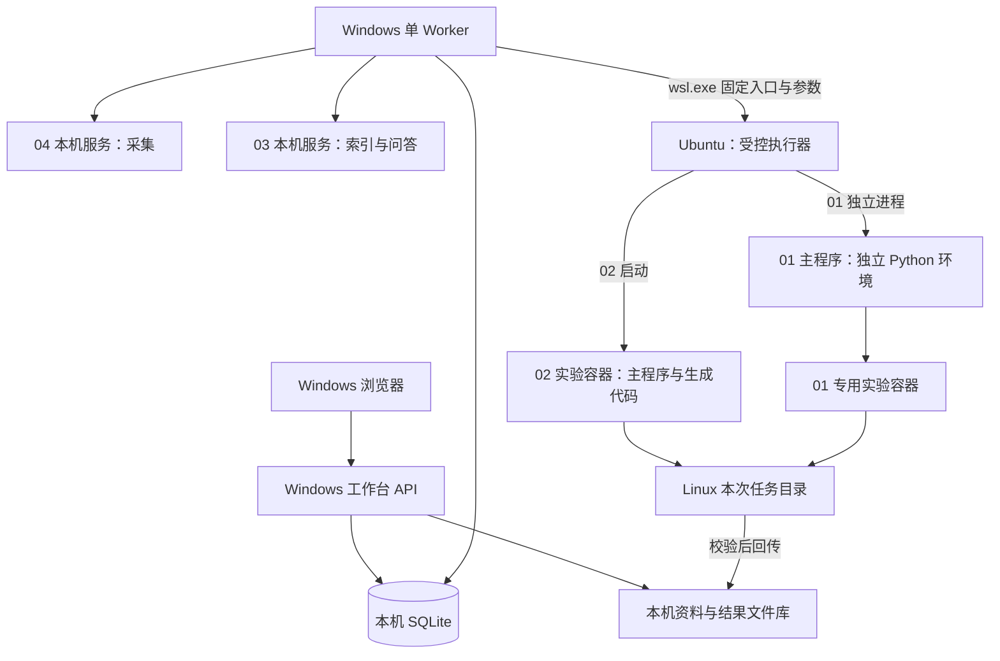

# 01/02 Linux 部署与四项目集成实施方案

日期：2026-10-22。状态：阶段 A 环境底座、阶段 B 离线交接已完成并验收通过；阶段 C～F 尚未实施，未执行真实实验。见[阶段 A 验收记录](deploy/linux/阶段A-环境验收记录-2026-10-22.md)与[阶段 B 验收记录](deploy/linux/阶段B-离线交接验收记录-2026-10-22.md)。

2026-10-24 状态提示：上一段及正文是 10 月 22 日的历史快照。后续 C–F 实施见[实际记录](deploy/linux/README-stages-c-f.md)，02 能力与限制见[最新功能验收](outputs/02-functional-check-20261024/README.md)；当前按[验收后整合方案](验收后整合方案-2026-10-24.md)已完成 [M0](outputs/integration-m0-20261024/README.md)与 [M1](outputs/integration-m1-20261024/README.md)。历史实测不代表当前服务在线或可信实验与论文全链路已完成。

## 1. 推荐方案与首版目标

采用 **Windows 工作台 + 一个 WSL2 Ubuntu + Docker Desktop WSL2 后端 + 独立实验环境**。先接入 02，完成一个真实小实验；再把 01 接成可选科研引擎。一次只运行一个科研实验。

首版交付链路：04 采集 → 人工批准资料 → 03 检索证据 → 人工确认实验方案 → 02 实验 → 归档代码、日志和指标 → 审核后回到 03。01 后续接受同一种研究任务包，执行自身研究流程，不强制将 01 和 02 串联。

本方案只新增工作台编排与薄适配层，不合并四套 Python 依赖。以下目录、协议、接口和限制除明确标注已存在者外，均为待实现。

## 2. 当前条件与实际缺口

本轮只读检查：

| 条件 | 结果 | 设计影响 |
| --- | --- | --- |
| WSL | 仅有 docker-desktop，WSL2，Stopped | 新增独立 Ubuntu；不将项目安装在 Docker 内部发行版中 |
| GPU | RTX 3060 Laptop，6144 MiB | 小模型、小数据、单实验；Linux 与容器内 CUDA 尚需验收 |
| 内存 | 系统可见 15.2GB，当时可用 4.4GB | 开始构建或实验前释放内存；按阶段启动重服务 |
| 磁盘 | C 约 26.8GB，E 约 539.9GB 可用 | Linux 虚拟磁盘优先放 E；Docker 数据位置另行核对 |
| 03/04 测试 | 上轮相关回归 62 通过；审核契约 32 跳过 | 同步已有测试基础；审核与版本管理不能视为已实现 |

内存与空间是检查时快照，不是资源保证。docker-desktop 停止不替代 Docker Engine 的专门可用性检查。

## 3. 部署拓扑

Ubuntu 与 Docker Desktop 是协作关系：Ubuntu 使用 Docker Desktop 提供的引擎及 WSL 集成，不再另外部署第二套 Docker daemon。01 主程序在 Ubuntu 调用 Docker；不把 Docker socket 挂入生成代码运行的容器，也不使用 Docker-in-Docker。

现有 03/04 本机 HTTP 桥接继续保留，本轮不改回旧架构稿中的 CLI 优先方案。工作台后续在其外层补项目、审核和版本约束。浏览器仍只访问 Windows 工作台；首版 Linux 执行器无需新增 HTTP 服务，也不依赖固定 WSL IP。

WSL2 提供真实 Linux 内核；Docker Desktop 的 Windows GPU 容器需要 WSL2 后端。[Microsoft](https://learn.microsoft.com/en-us/windows/wsl/about)、[Docker GPU](https://docs.docker.com/desktop/features/gpu/)

## 4. 目录、依赖与资源安排

### 存储与源码

- Windows 主仓库保留在 `E:\work\ai-security-class-project`。
- Ubuntu 24.04 LTS 虚拟磁盘拟放 `E:\WSL\Ubuntu-24.04`，实施前核对本机 WSL 的安装位置支持，不注销或覆盖已有发行版。
- Linux 内使用 `~/research-runtime/`：`engines/01/`、`engines/02/` 保存版本化运行源码，`runs/<task_id>/` 保存每次实验输入、有效配置、日志及产物。
- Windows 使用 `workbench/data/` 保存 SQLite、批准快照和最终产物；`workbench/exchange/<task_id>/` 仅作为任务包交换目录。
- 执行器从 `/mnt/e/.../exchange/` 校验并复制输入到 Linux 文件系统，实验结束后按产物清单回传。大规模读写和 Python 环境留在 Linux 文件系统。[Microsoft 文件存储建议](https://learn.microsoft.com/en-us/windows/wsl/interop)
- 每次输入记录 Git 版本及实际源码快照哈希；存在未提交文件时必须记录其内容摘要。Linux 副本不独立开发，修改先回主仓库，再重新同步快照。排除密钥、Windows 虚拟环境及无关输出。

### 环境与初始配额

| 项目 | 初始设计 |
| --- | --- |
| Python | 02 使用 Python 3.11；01 主程序优先 3.11，实验镜像按其实际兼容矩阵单独验证 |
| 依赖 | Linux 内 uv 管理；02 先建立验证环境，再用同一锁定清单构建镜像；01 单独锁定 |
| 镜像 | 记录固定 tag 和实际 digest；验证后冻结，不长期依赖 latest |
| CPU/内存 | 02 容器初始 4 CPU、4GiB 内存；出现 OOM 如实判失败，再缩小实验或评估调整 |
| 并发 | 一个 Worker，一次一个重实验；03 批量索引与实验错峰 |
| 显存 | 共享本机 6GB GPU；普通容器内存参数不是显存配额，以小模型和 batch 控制 |
| 总时长 | 第一轮 30 分钟，由外层监督器计时并停止本次容器 |
| 磁盘 | E 盘先预留约 80GB 作为规划值；下载前查看镜像体积，依实测修正 |

安装前建议释放到至少约 6GB 可用内存，实际仍由构建和试跑峰值决定。先不修改全局 `.wslconfig`。Docker 数据盘若不在 E，使用官方设置确认迁移办法及现有数据后另行处理。

WSL 使用 Windows NVIDIA 驱动，不在 Ubuntu 安装 Linux 显示驱动。优先验证预编译 PyTorch GPU 包，只有编译扩展确有需求时才补 Toolkit。[NVIDIA WSL 文档](https://docs.nvidia.com/cuda/wsl-user-guide/contents.html)

## 5. Windows 与 Linux 如何交接

工作台负责排队和 SQLite；Linux 执行器只读任务包、运行引擎并返回结果，不访问 SQLite。

执行器拟提供 `probe / submit / status / cancel / collect` 五个固定子命令。Windows 使用参数数组调用 `wsl.exe -d Ubuntu-24.04 -- <固定执行器路径> ...`，不把用户输入拼成 shell 命令。长任务提交后返回 task_id 和容器/进程标识，后续轮询状态。

执行器先校验整个输入包，再原子写入已接收记录并启动。相同 task_id、相同输入哈希返回现有任务；同 ID 不同哈希报冲突。任务 ID 只接受安全字符；文件路径限制在本次任务目录，拒绝绝对路径、目录穿越及逃逸符号链接。

启动和记录外部 ID 之间的崩溃窗口，通过确定性的容器名称及任务标签对账；不能发现状态就标记 interrupted，不自动重复执行可能收费的模型任务。取消后确认本次进程和容器均停止，再报告 cancelled。Linux 监督器独立于 Windows 轮询维持总超时。

## 6. 统一输入与结果契约

研究任务包 `research_package.json` 最少包含：

| 字段组 | 内容 |
| --- | --- |
| 身份 | schema_version、project_id、task_id、attempt、engine |
| 证据 | approved_manifest_hash、document_id/version/sha256/content_level 及相对文件清单 |
| 实验方案 | question、hypothesis、method、dataset_id/version/hash、baseline、metrics、seeds |
| 批准记录 | 方案版本、方案哈希、reviewer、reviewed_at；资料批准不自动等同于实验方案批准 |
| 运行配置 | config_hash、source_snapshot_hash、镜像标识、迭代与时间限制 |

只有先前批准的资料进入冻结输入包。03 的问答提供证据整理，实验方案仍需人工确认；摘要证据保留 abstract 标识，不当全文使用。新数据集或来源的补充会生成新版本并重新审核。

首版结果统一为 `result.json`：task_id、输入包哈希、engine、运行状态、退出码、失败原因、起止时间、实际生效配置、代码和镜像版本、metrics、产物相对路径与 SHA-256、已知调用用量。未知费用保持未知，不填 0。

运行状态与科研验收分开：`execution_status` 表示程序是否完成；`validation_status` 表示指标和证据是否经检查。退出码为 0 但缺少约定指标时不能通过验收。实验结果作为“本项目实验记录”进入待审资料，不能冒充外部论文来源。

## 7. 02 的第一阶段接入

新增适配器完成三步：研究任务包 → 上游 Idea JSON 和有效 YAML；在任务独立目录运行现有入口；解析这一个选定实验的结果并返回统一清单。

源码已确认：`launch_scientist_bfts.py` 使用 `--load_ideas`、`--idea_idx`，固定从当前工作目录读取 `bfts_config.yaml`，并生成 `experiments/<时间>_<Name>_attempt_<编号>/`。因此任务目录内放独立配置，容器设置正确工作目录和源码导入路径。Idea JSON 必须按上游字段转换，不能直接传通用研究任务包。

首轮配置：num_workers=1、num_seeds=1、四阶段迭代上限 2/2/1/1、num_drafts=1、max_debug_depth=1、单次执行 timeout=300 秒。调用 `--skip_writeup --skip_review`，并显式校验代码、反馈、视觉及绘图模型配置；这两个开关仍会执行模型调用和绘图聚合。

首个用例建议选固定种子的合成二分类数据：以简单基线和小型 MLP 对比，固定训练/测试划分，输出 accuracy、训练耗时、种子和数据哈希。目标是验证从资料到实验记录的链路，不据此宣称科研创新。需要保存实际执行代码，核验数据划分和指标计算，不能仅信任模型生成的数字。

模型服务先核对文本、结构化输出及图像能力；当前默认配置混用 Bedrock 和 OpenAI，不能只配置一个 Key 就运行。模型调用预算在试跑前确定；迭代数和总超时不等同于金额硬限制，需供应商额度或经过验证的调用预算控制。

## 8. 01 的后续接入与特有阻塞

01 主程序运行于 Ubuntu 独立进程，包装 `main_ai_researcher(input, reference, mode)`；每个任务具有独立工作目录、环境变量、容器名、端口和输出清单。进程内存在全局状态及 chdir，不直接导入 Windows API 进程执行。

本轮发现两个必须单独验收的问题：

1. `docker/Dockerfile` 使用浮动 `pytorch/pytorch:latest`，随后安装 torch 1.13.1+cu116 和对应旧 PyG 包；注释所述版本与实际命令也不同。不能假定它与现代基础镜像/Python 一起可构建。先检查预构建镜像可获取性和内部版本，成功后固定 digest；失败则针对选定样例确定完整兼容组合，再修改 Dockerfile。01 不强行与 02 共用镜像。
2. `research_agent/inno/environment/docker_env.py` 当前以 root 启动、使用 unless-stopped、缺少 CPU/内存限制且发布容器端口。接入前需最小补丁增加任务归属、资源限制、受控监听及退出清理；验证容器通信、写目录权限和停止行为。非 root 改造是否兼容需实际验收，不宣称现有镜像已满足。

01 原有容器与主进程之间使用 localhost TCP。必须在实际 WSL/Docker 网络模式下验证连通性；若不通，显式配置可达地址并限制端口暴露，不把 localhost 跨环境等价作为前提。

先运行一个已有最小样例，再接研究任务包；论文写作最后单独接入。此前记录的资源文件改名问题，需要对实际选用样例核对文件引用。01 未就绪时在工作台显示具体缺项，02 与资料链路仍可使用。

## 9. 分阶段实施与验收门槛

| 阶段 | 实施内容 | 必须拿到的证据 |
| --- | --- | --- |
| A：环境底座 | Ubuntu 放 E、普通用户、Docker WSL 集成、02 Python 3.11 与依赖 | WSL 版本；Ubuntu GPU 可见；PyTorch GPU 运算；依赖检查；容器 GPU 运算；镜像/环境版本记录 |
| B：离线交接 | 任务包、执行器五个操作、模拟引擎、状态与结果回传 | Windows 提交→Linux 假任务→结果回传；哈希一致；重复提交、取消、超时、重启对账通过；模型请求数为 0 |
| C：资料与方案 | 实现已写的审核/版本契约，补 ResearchPackage 测试 | 32 个契约测试开启严格模式后全部通过；未批准或过期资料不能进入实验；方案批准版本可追溯 |
| D：02 首次真实实验 | 小数据、单任务、确认模型和预算后执行 | 实际代码、数据/配置哈希、日志、可核对指标、用量；资料→实验→结果完整记录 |
| E：01 适配 | 处理镜像与容器启动差异、样例验证、接同一任务协议 | 同一执行器可选择 01；独立运行记录；失败不影响 02；资源及停止规则实测 |
| F：可选写作 | 补充 TeX/PDF 工具与报告界面 | 引用对应批准证据，实验数字对应实际产物；PDF 编译与人工审核分别记录 |

A 与 B 的接口设计可以先推进；正式付费实验必须等 A、B、C 的验收完成。A 未完成时，模拟测试仍能开展，但不计作 GPU 或引擎验收。

拟新增工作台模块：`adapters/scientist02.py`、`adapters/researcher01.py`、`services/research_package.py`、`services/experiment_result.py` 与 Linux `executor/`。首版仍使用 SQLite + 单 Worker + 本地文件，暂不引入 Redis、对象存储或通用工作流平台。

## 10. 测试与交付

沿用现有同步回归及审核契约，再补：任务包审批/哈希/路径校验、Idea 字段映射、有效配置生成、缺模型配置拒绝启动、任务幂等、超时取消、失败后新 attempt、跨项目产物隔离、返回结果哈希及缺指标拒绝验收。单元测试使用模拟进程和模拟容器命令；真实 GPU、镜像兼容、模型能力及指标正确性使用独立集成验收。

交付包括部署脚本、依赖锁、固定镜像引用、示例任务包、执行器与适配器、单元测试、真实小实验记录及可复现步骤。方案编写时仅交付本设计文档；后续阶段 A 已完成 Ubuntu、依赖与镜像安装及 GPU 验收，阶段 B 已实现五操作执行器、模拟引擎和 Windows 结果回传，并通过实际 WSL 重启对账。部署脚本、依赖锁、样例和原始证据位于 `deploy/linux/`，执行器位于 `executor/`，Windows 客户端位于 `workbench/offline_client.py`。尚未调用付费模型；真实实验、审核服务及真实引擎适配仍待后续阶段。

实施起点是阶段 A 的 Ubuntu/GPU 底座和阶段 B 的离线协议；先把 02 跑通并留下可复核证据，再投入 01 的镜像兼容工作。

### 2026-10-23 实施更新

上文“尚未调用付费模型”等内容为 A/B 交付时的历史状态。当前 C 的审核与方案契约已实现，严格模式测试通过；D 已调用 DeepSeek 并保存真实尝试，v2 流程正常完成，但缺少最终指标文件且代码偏离批准方法，验收失败。E 的官方固定镜像已完成非 root GPU、TCP、资源限额及停止验证；01 主环境安装受依赖下载超时影响，完整引擎接入尚未完成。F 已输出并检查 PDF 草稿，TeX 编译受应用沙箱限制。当前状态与命令见 `deploy/linux/README-stages-c-f.md`，不得按本设计表将未验收项目记为完成。
