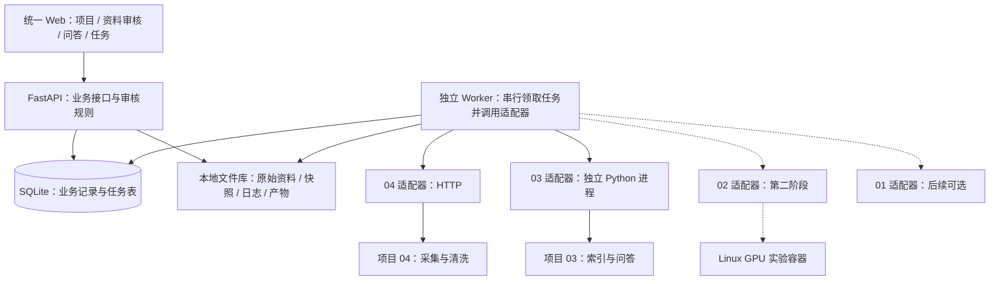

# AI 科研工作台：设计审核与简化架构

日期：2026-10-21。依据：用户提供的设计稿、当前四个项目源码，以及本轮环境核查结果。

2026-10-24 状态提示：本文保留历史设计语境；最新执行顺序以[验收后整合方案](验收后整合方案-2026-10-24.md)为准，当前已完成 [M0 离线验收](outputs/integration-m0-20261024/README.md)与 [M1 本机主线验收](outputs/integration-m1-20261024/README.md)。下文“待实现”等描述不可作为当前能力或服务在线结论。

本方案按“三人课程团队、单机本地演示、少量资料、一次一个重任务”设计。下文新增接口与模块均为待实现方案；源码入口已做静态核对，跨项目链路尚未联调。

## 1. 审核结论

原方案的方向可行：统一入口、独立项目环境、适配器、版本化资料和人工审核都应保留。主要需要收缩首版范围，并补上任务归属、资料类型和证据校验三个缺口。

| 设计点 | 审核意见 | 简化后的决定 |
| --- | --- | --- |
| 统一 Web + FastAPI + 适配器 | 保留，适合现有 Python 项目 | 新增一个薄工作台，负责项目、审核、任务、文件清单，不重新实现采集和 RAG |
| 四套依赖独立安装 | 必须保留 | HTTP 或独立解释器进程调用，工作台不直接导入四个项目全部依赖 |
| PostgreSQL + Redis + MinIO | 对当前单机首版偏重 | SQLite + 本地文件目录 + 一个独立 Worker；有多机、多 Worker 或明显写入竞争时再升级 |
| 一次建设八大业务模块 | 范围过大，环境也未齐全 | 首版只做“采集 → 审核 → 入库 → 带来源问答” |
| 01、02 同时接入 | 两者能力重叠、适配成本不同 | 第二阶段先接 02；01 作为后续可选引擎，不强制串联 |
| 全流程暂停、恢复、自动重试 | 上游没有统一支持 | 支持排队、取消请求、失败后新建重试；只在阶段边界继续，不承诺中途断点恢复 |
| 预算字段 | 可以保留，但字段不等于限制生效 | 首版限制并发、时长、迭代数并记录用量；金额仅估算，硬额度需供应商限制或统一调用控制 |
| 论文工作台 | 延后 | 先导出包含来源和实验记录的 Markdown 报告，再考虑 LaTeX/PDF 和论文编辑 |

单机低并发选择 SQLite 是本方案的工程判断：官方说明其适合本地应用及低到中等流量服务，但同一时刻只有一个写入者，数据库应放本机磁盘，不通过网络共享给多台机器写入。[SQLite 适用场景](https://www.sqlite.org/whentouse.html)

## 2. 推荐架构



**部署方式：**工作台 API、Worker、SQLite、文件库在 Windows 本机；项目 04 使用现有服务；项目 03 使用独立环境，首版通过 CLI/小型桥接脚本调用，不必同时维护其完整网页。第二阶段的项目 02 在 Linux GPU 容器执行，Worker 负责准备输入包、启动容器、回收产物。Linux 执行器不直接读写工作台 SQLite。

**界面只保留四页：**项目总览、资料审核、知识问答、任务记录。实验中心在第二阶段增加。可复用项目 04 的表格、列表和样式实现，但不把业务页面嵌套为四套 iframe。

**业务边界：**工作台管理“哪个研究项目批准了哪一版资料、执行了哪次任务”；04 管采集；03 管索引和检索；02/01 管实验。工作台保存外部对象 ID 映射，不直接修改项目内部数据库。

## 3. 必须先处理的真实接口问题

### 04：接口能复用，但需要补任务归属

现有接口包括 `POST /api/crawler/start`、`GET /api/crawler/status`、`GET /api/crawler/logs`、`POST /api/data/analyze`。采集管理器是单实例进程状态：启动响应没有任务 ID，结束可能回到 `idle`。**不能把 idle 当成功，也不能把目录中新出现的任意文件算作本次结果。**

最小补丁建议：采集启动接受工作台生成的 `run_id`，任务记录持久保存 `run_id、参数、退出码、错误、输出文件清单`；输出以 run_id 隔离，并返回可查询的任务结果。采集器/写入器需要将该标识传递到文件落盘层。04 适配器同一时刻只提交一个采集任务。协议补丁完成前，可用人工选定 JSONL 导入验证后续链路，界面明确标记“手动导入”。

当前 arXiv 采集器保存标题、作者、摘要、链接与日期，GitHub 采集保存仓库元数据；**没有自动获取论文 PDF/全文的完整步骤**。首版将摘要规范化为 Markdown 来源卡，并标记 `content_level=abstract`。用户上传全文后另建版本，不能把摘要问答展示为全文精读。

04 现有 Idea 生成按主题组织本地资料，不具备工作台的项目/审核版本约束。第二阶段应让适配入口显式接受“已批准记录 ID / 证据快照”；如果无法做到，工作台按已批准证据单独构造一次受控生成请求。不能直接把现有全局 Idea 接口接到多个研究项目上。

### 03：首版只封装入库和一次问答

源码提供 `deeptutor kb create <name> --docs-dir <dir>` 和 `deeptutor run chat <question> -t rag --kb <name> --format json`。首版优先在 03 的独立环境运行这两个入口，固定运行主目录及配置，不再额外开发一套 RAG。

需注意 `--format json` 返回的是 **逐行 JSON 事件流（NDJSON）**，不是单个结果对象。适配器应收集完成/失败事件，提取回答和检索来源；不能只检查进程退出码。若当前事件不足以返回来源信息，再在 03 环境增加一个薄桥接脚本，调用其已有应用层并输出工作台需要的结构。

每次批准材料发生变化，首版新建 `项目ID + 索引版本` 对应的小型知识库；只有入库校验通过才切换活动版本，旧版保留。这样避免未审核资料、旧索引或其他研究项目进入回答。小规模先用现有 LlamaIndex 路径，配置与该路径匹配的模型、嵌入服务。

### 02 / 01：先接 02，分别做能力声明

02 已有 `launch_scientist_bfts.py --load_ideas ... --idea_idx ...` 入口，读取固定工作目录下的 `bfts_config.yaml`，适合先封装一次实验。适配器把批准的研究包转换成它实际读取的 Idea JSON，并为每次执行准备独立目录、配置和输入清单。传入一个通用 Research Package 并不代表上游会自动落实其中的数据集、指标和资源约束。

01 的网页调用 `main_ai_researcher(input, reference, mode)`，实现包含环境变量、全局状态和工作目录切换。后续应在独立进程包装，不能直接作为 FastAPI 请求中的可重入函数。

04 现有 `/scientist/production` 面向另一种外部框架约定，其完整论文模式使用了课程项目 02 没有的 `--writeup_codex` / `--review_codex` 参数。工作台应单独适配项目 02，不能复用这条命令即认为兼容。

## 4. 一条完整的数据传递链

```text
研究项目
  → 04 采集任务：得到本次 JSONL 清单
  → 工作台规范化：来源卡 + 来源 ID + 内容哈希
  → 人工批准具体资料版本
  → 导出 approved_manifest.json + 批准的 Markdown/PDF
  → 03 为这份清单构建一个知识库版本
  → 提问：固定使用该版本
  → 回答：保存引用来源、证据片段、问答记录
```

文件可以复制，但必须由适配器按照清单复制并校验。工作台通过 `artifact_id` 定位本地文件，再向上游上传或复制到其输入目录；不要求 Windows、Linux 和容器具有相同绝对路径，也不把整个运行目录共享给所有项目。

首版只固定以下几个契约，由 Pydantic 模型导出 JSON Schema，避免手写两套重复协议：

| 对象 | 最少字段与规则 |
| --- | --- |
| Document | `document_id、project_id、source_type、source_id、source_url、title、version、content_level、artifact_id、sha256`；正文不变则版本不变 |
| Review | `target_id、target_version、decision、reviewer、reviewed_at、comment`；修改正文产生新版本，新版本默认待审 |
| Task | `task_id、project_id、type、status、input_snapshot、attempt、external_run_id、error、created_at、finished_at` |
| Artifact | `artifact_id、relative_path、sha256、content_type、producer_task_id`；路径由服务端解析且限制在指定根目录 |
| KBVersion | `project_id、version、approved_manifest_hash、external_kb_name、status`；不把工作台版本号等同于上游内部索引号 |
| Answer | `question、kb_version、answer、citations[]`；每条引用含 document_id、version、可核对定位和证据片段 |

引用必须能映射回本次批准清单。摘要来源卡使用段落位置；真实 PDF 解析提供页码时才填写页码。定位不明、正文不匹配或无引用时，标记“待核验/证据不足”，不能生成假的页码或引用。

第二阶段再增加 `ResearchPackage` 与 `ExperimentResult`：研究问题、假设、批准证据、数据集版本、基线、指标口径、种子、配置哈希、代码版本/文件哈希、镜像标识、产物清单。结果完成与人工验证通过分别记录；暂时只做一个选定实验的指标解析，不承诺通用解析任意生成代码的结果。

## 5. 最小任务机制和 API

API 接收请求后先写任务表并返回 `202 + task_id`。独立 Worker 通过短事务领取任务，一次处理一个重任务。前端每 2–3 秒轮询，首版无需 SSE。读列表和审核不受长任务执行阻塞，其他重任务显示排队状态。

任务状态建议：`queued → running → succeeded / failed`；取消经过 `cancel_requested → cancelled`，异常恢复无法判定结果时用 `interrupted`。审核状态单独使用 `pending / approved / rejected`。首版由用户点击进入下一阶段，不需要通用 DAG 编排器或独立 workflow_runs 表。

最少要落实以下规则：

- 重复提交使用 `idempotency_key`，任务表唯一约束去重。明确重试会新建 attempt，不覆盖旧日志与产物。
- Worker 记录心跳和外部 run_id/容器 ID；重启后先查询实际执行状态。外部任务状态不明时标记 interrupted，禁止自动重复提交可能收费的实验。
- 所有外部操作设超时；取消只有在确认子进程/容器停止后才标记 cancelled。不支持中途暂停的引擎，不显示“暂停后继续”。
- 不在长时间模型调用期间持有数据库写事务。工作台 API 与 Worker 访问同一本地数据库，配置短事务和有限的锁等待。
- `succeeded` 必须由适配器校验：采集有合法结果清单（允许明确的 0 条结果）、入库完成且版本对应、问答有有效完成事件；进程退出 0 不代表科研结果有效。

独立 Worker 是本方案的简化执行方式；FastAPI 的请求后 BackgroundTasks 不作为耐久任务队列。官方也将较重、跨进程的后台计算与应用内小任务区分。[FastAPI 后台任务说明](https://fastapi.tiangolo.com/tutorial/background-tasks/)

以下均为**拟新增的工作台接口**，不是宣称上游已经具备：

| 接口 | 用途 |
| --- | --- |
| `POST /api/v1/projects`；`GET /api/v1/projects/{id}` | 创建与查看研究项目 |
| `POST /api/v1/projects/{id}/collection-jobs` | 创建采集任务；接入前也支持受控的手动 JSONL 导入 |
| `GET /api/v1/projects/{id}/documents` | 查看资料、正文级别和审核状态 |
| `POST /api/v1/documents/{id}/reviews` | 提交针对具体版本的审核；旧版本冲突返回 409 |
| `POST /api/v1/projects/{id}/index-jobs` | 冻结批准清单并创建知识库版本 |
| `POST /api/v1/projects/{id}/question-jobs` | 固定知识库版本执行问答 |
| `GET /api/v1/tasks/{id}`；`POST /api/v1/tasks/{id}/cancel` | 查询状态/结果，申请取消 |
| `GET /api/v1/artifacts/{id}` | 按 ID 读取或下载产物 |
| `GET /api/v1/capabilities` | 分项返回采集、入库、问答、实验是否可用及缺项 |

能力状态不能只用一个 health=true：至少区分 `configured、runtime_ready、last_verified_at、blocked_reason`。有非空 Key 仅代表已配置，模型和嵌入需分别验证；03 或实验引擎不可用时，已部署的采集、审核和资料查看仍可继续使用。

## 6. 目录与实施顺序

建议在当前课程仓库新增 `workbench/`，方便同一仓库协作、复用已有源码和课程提交流程；有独立发布需求时再拆仓库。

```text
workbench/
├── web/                   # React + TypeScript，四个基础页面
├── backend/
│   ├── api/               # 项目、资料、审核、任务接口
│   ├── schemas/           # 唯一契约定义
│   ├── services/          # 业务校验、清单、版本
│   ├── adapters/          # 04、03；第二阶段增加 02
│   ├── worker.py          # 独立任务进程
│   └── db/                # SQLite 模型与迁移
├── bridges/deeptutor/     # 必要时添加，使用 03 的解释器运行
├── tests/                 # 适配器契约与端到端小样本验收
└── runtime/               # 本地数据库、文件库、日志；加入 Git 忽略
```

| 阶段 | 工作内容 | 完成标准 |
| --- | --- | --- |
| 0：证明 04 → 03 可接通 | 补 03 环境和模型/嵌入配置；从 04 现有资料导出 5 份明确标注为摘要的来源卡；用 CLI 建库和问答 | 能回答一个资料内问题并核对引用；对资料外问题能说明证据不足；保存原始输入输出。失败先修适配，不先做完整网页 |
| 1：工作台 MVP | 薄后端、四个页面、SQLite/Worker、04 的 run_id/结果清单补丁、审核和索引版本 | 采集约 10 条、批准其中 5 条，只有这 5 条进入活动索引；刷新页面任务不丢失；重复点击不重复执行；取消/失败如实显示 |
| 2：一个真实实验 | 批准证据生成 Idea/研究包；部署 02 Linux/GPU 环境；冻结一次小实验配置 | 完成一次小型基线/方法对比，保留代码、数据版本、日志和可核验指标；模型任务有明确范围，失败不伪装成成功 |
| 3：可选扩展 | 01 适配、重复实验、结果比较、Markdown 报告，再按需要做论文导出 | 每项能力单独通过验收后启用；01、02 为可选引擎 |

三人可按 A＝04 接入与资料规范化、B＝03 入库问答（随后负责 02）、C＝工作台与任务管理分工。先共同确认契约和样本，C 使用显式标记的 Mock 开发界面，里程碑验收必须切到真实适配器。这样比把 01、02 两套未部署引擎都交给 B、把整个论文模块也交给 C 更均衡。

实验代码在第二阶段使用受限 Linux 容器执行，只提供本次输入和输出目录；宿主调度器持有容器控制权限，生成代码不获得 Docker 控制接口或整个用户目录。模型凭据按实际需要注入，科研材料本身不能授予执行或读取其他项目资料的权限。

## 7. 审核依据与当前边界

- 04 采集启动/状态：[crawler.py](<E:/work/ai-security-class-project/projects/project-04-Intelligence Gathering/api/routers/crawler.py:27>)、[crawler_manager.py](<E:/work/ai-security-class-project/projects/project-04-Intelligence Gathering/api/services/crawler_manager.py:98>)。
- 04 arXiv 实际输出：[research/core.py](<E:/work/ai-security-class-project/projects/project-04-Intelligence Gathering/media_platform/research/core.py:117>)；Idea 输入与实验命令：[scientist.py](<E:/work/ai-security-class-project/projects/project-04-Intelligence Gathering/api/routers/scientist.py:711>)。
- 03 入库入口：[kb.py](E:/work/ai-security-class-project/projects/project-03-deeptutor/deeptutor_cli/kb.py:220)；问答参数：[main.py](E:/work/ai-security-class-project/projects/project-03-deeptutor/deeptutor_cli/main.py:81)；NDJSON 事件：[common.py](E:/work/ai-security-class-project/projects/project-03-deeptutor/deeptutor_cli/common.py:185)。
- 02 实验入口：[launch_scientist_bfts.py](E:/work/ai-security-class-project/projects/project-02-ai-scientist-v2/launch_scientist_bfts.py:182)；01 的实际函数入口：[main_ai_researcher.py](E:/work/ai-security-class-project/projects/project-01-ai-researcher/main_ai_researcher.py:35)。
- [四项目环境核查](E:/work/ai-security-class-project/四项目环境核查-2026-10-21.md)：当前只有 04 基础服务通过运行核验，03 与实验环境仍需补齐。

本次交付为设计审核和实施方案，未创建工作台代码或部署新服务。建议下一步直接执行阶段 0，用 5 份来源卡验证 04 → 03 的真实输入、输出和引用质量，再进入工作台开发。
