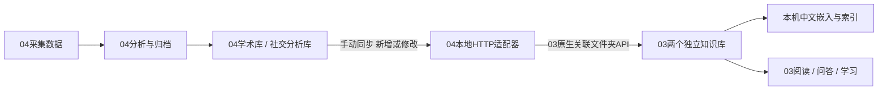

# 项目03、04功能核查与联通

核查日期：2026-10-21，当前课程副本、单机部署。注册到后端不等于逐项验收成功；下表区分实测、配置就绪和缺项。

## 1. 项目03有哪些功能

实际接口 `/api/capabilities/registered` 返回12个能力：

| 能力 | 用途 | 当前判断 |
| --- | --- | --- |
| `chat` | 对话、附件问答、知识库检索 | 真实对话、附件与原验收知识库问答通过 |
| `ask_questions` | 通过追问澄清需求 | 已注册，未单独实测 |
| `deep_solve` | 多步骤解题 | 已注册，未单独实测 |
| `deep_question` | 生成练习题 | 已注册，未单独实测 |
| `deep_research` | 分解问题、研究、生成报告 | 已注册；独立联网搜索服务尚未配置，未验收完整研究流程 |
| `visualize` | SVG、Mermaid、Chart.js、交互HTML | 基础渲染后端就绪，未逐项生成验收 |
| `math_animator` | Manim数学动画 | 已注册，但缺少Manim运行环境 |
| `mastery_path` | 掌握度导向学习路径 | 已注册，未单独实测 |
| `immersive_reading` | 围绕文档阅读、解释和练习 | 已注册，未验收完整阅读流程 |
| `course_study` | 围绕课程资料学习 | 已注册，未单独实测 |
| `immersive_watching` | 视频与时间戳学习 | 已注册，YouTube播放配置就绪；字幕访问和完整流程未实测 |
| `audio_overview` | 生成音频概览 | 已注册，语音模型尚未配置 |

支持知识库、学习空间、笔记、记忆、历史会话、任务与工具管理。现有模型为 `deepseek-flash`；嵌入为本机CPU上的 `BAAI/bge-small-zh-v1.5`、512维。

就绪接口还显示：头脑风暴、论文搜索的工具入口可用；SVG、Mermaid、Chart.js、HTML渲染器就绪。论文外网检索未在本轮重测，Zotero入口存在不代表已经核验本机文库连接。

缺项包括：独立搜索服务、专用推理工具后端、语音识别/合成、图片生成、视频生成、GeoGebra及Manim。MinerU、PyMuPDF4LLM等解析器有可选入口，当前选择的是纯文本解析；OCR和扫描PDF不在本次验收范围。

## 2. 项目04当前状态

| 功能 | 核查结果 |
| --- | --- |
| 网页、数据文件与归档查看 | 服务已恢复；43个本地数据文件，学术归档51份、社交/分析归档5份 |
| arXiv、GitHub采集 | 源码和已有采集记录存在；本轮没有重新采集 |
| 社交平台采集 | 有入口，仍需本人登录及平台实测 |
| 规则清洗、去重、关键词、分析归档 | 有现成流水线及历史产物；本轮保留原数据 |
| AI摘要、研究Idea | 当前04的 `ai_enabled=false`，不能将03模型可用等同于04已配置模型 |
| 外部自动实验 | `preflight.ready=false`，兼容实验框架及工作区缺失 |
| 前端源码重新构建 | 已补齐缺失的数据浏览、预览弹窗及知识库组件，类型检查和生产构建通过；学习问答已集成到侧栏 |

51和5是Markdown文件数量，包含来源卡、目录及分析报告，不等同于论文全文数或原始社交条目数。

## 3. 已实现的数据联系

- 联通入口：04侧栏的[学习问答](http://127.0.0.1:8080/?view=learning)；旧 `/deeptutor` 地址重定向到该栏。
- 学术资料：[ig04-academic](http://127.0.0.1:3782/knowledge-bases/ig04-academic)，已导入51份。
- 社交与分析资料：[ig04-social](http://127.0.0.1:3782/knowledge-bases/ig04-social)，已导入5份。
- 04新增 `GET /api/deeptutor/status`、`POST /api/deeptutor/sync/{academic|social}`，通过HTTP调用03，不混用Python依赖环境。
- 重复同步实测返回 `unchanged`、新增0、修改0；原始目录不被改写。03原生任务负责索引和进度，提交任务不直接宣称索引成功。
- 固定两个联通知识库；若同名知识库关联其他目录，会拒绝覆盖。03离线会显示启动提示，正在索引的知识库不能重复提交。
- 首次创建知识库会记录本机03地址、库名和目标目录；关联目录失败后重试，只有匹配这份归属记录且文档数明确为0的库才允许补做关联。未知归属、非空、文档数未知或只读的空库继续拒绝覆盖。
- 不自动删除03中的旧文档，也不自动定时同步；04归档新增或修改后再次点击同步。

## 4. 使用步骤

1. 启动03：在课程仓库根目录运行 `.\projects\project-03-deeptutor\start-local.ps1`。
2. 启动04：在04目录运行 `.\.venv\Scripts\python.exe start.py`。如果现有后台服务已运行，无需重复启动。
3. 在04完成采集、内容分析和知识库归档，然后打开联通页面，选择学术或社交资料，点击“同步到03”。
4. 等待状态为“已就绪”，点击“在03打开”。在03对话的“资源”中选择对应知识库，再要求解释、比较、生成问题或查找来源。
5. 核对来源卡中的URL与04归档内容。归档中的摘要可能截断；不要把来源卡学习当成阅读全文。

默认03后端为 `http://127.0.0.1:8001`，网页为 `http://127.0.0.1:3782`。如更改端口，在04进程环境中设置 `DEEPTUTOR_API_URL`、`DEEPTUTOR_WEB_URL` 并重启04；只接受本机HTTP地址。没有复制03密钥到04。

## 5. 验证与证据

- 联通适配器和04原采集API回归：25项测试通过，含首次关联失败后恢复、未知/非空库保护。
- 两库实际入库、原生索引及本地检索通过；学术检索命中指定文献的原链接 `2505.18333`，社交报告检索命中原始批次和47/45/23等记录数字。
- 桌面与390像素手机网页检查通过，无横向溢出、无JavaScript异常；重复同步按钮实测通过。
- 集成后的主页面另验收：侧栏进入学习问答、旧入口重定向、重复同步、03离线时禁用同步，以及采集文件预览、知识库原文预览和日志页数据弹窗；均通过，无JavaScript异常。
- 本轮证据保存在课程仓库 `outputs/03-04-integration/`，仅供本机核验；其检索片段包含04已有归档内容。
- 经用户明确授权，使用已配置的DeepSeek完成两次外部问答：学术库正确返回 `http://arxiv.org/abs/2505.18333v1` 并说明摘要截断；报告库正确返回47条分析记录、45条Prompt Injection主题内容和23条RAG主题内容。
- [学术来源问答](http://127.0.0.1:3782/chat/unified_1792586533229_57314f2e)；[报告来源问答](http://127.0.0.1:3782/chat/unified_1792586546144_ab5c9cd3)。验收核对了这些字段，不代表答案中的所有解释均已验证。例如报告回答将两个相同统计值的批次推断成“同一批数据的重复产出”，这一点尚未核实，应保留为待核验判断。

提交内容包含03本地环境支持、04分析/Idea修复和联通页面；模型密钥、依赖环境、模型缓存、知识库及上述本机验收输出不随代码提交。实验框架接入不在本次范围内。
